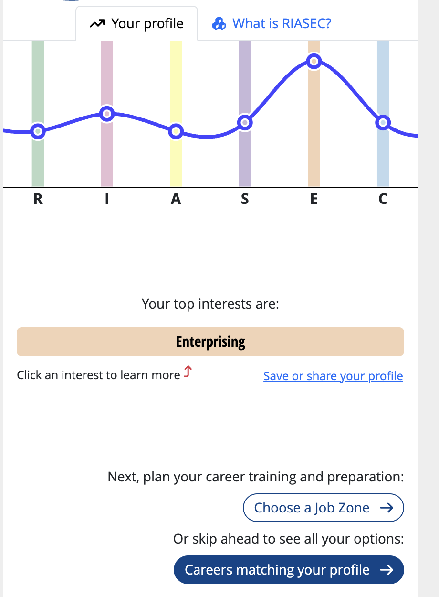

# RIASEC Profile Summary Activity

This activity walks you through taking the RIASEC assessment, interpreting your results, and connecting them to everything you already know about yourself from Module 2. By the end, you will have a complete **RIASEC Profile Summary** in your GitHub portfolio.

---

## Step 1 — Take the RIASEC Assessment

Complete the free RIASEC assessment using one of the following recommended tools:

- **O*NET Interest Profiler (Recommended)**
  Visit: [www.mynextmove.org/explore/ip](https://www.mynextmove.org/explore/ip)
  This is the official U.S. Department of Labor version — free, reliable, and directly linked to career data.

- **CareerOneStop Interest Assessment**
  Visit: [www.careeronestop.org/toolkit/careers/interest-assessment.aspx](https://www.careeronestop.org/toolkit/careers/interest-assessment.aspx)

Take the full assessment. Answer based on genuine interest, not perceived ability or what sounds impressive.

**Assessment I took:** O*NET Interest Profiler (My Next Move), October 2026.

---

## Step 2 — Record Your Results

When you finish, record the following:

### My Holland Code

**My three-letter Holland Code:** **E-I-C** (Enterprising, Investigative, Conventional)

The profiler shows results as a chart, not as numbers, so I ranked each type by how high it landed. Enterprising was far above everything else and was the only area the profiler listed as a "top interest." Social and Conventional came out almost exactly tied for third. I chose Conventional for my code because most of the careers I'm targeting are coded with a C on O*NET.

| Type | Score | Strength Level |
|---|---|---|
| Realistic (R) | 5th (tied with Artistic) | Lower |
| Investigative (I) | 2nd | Moderate |
| Artistic (A) | 5th (tied with Realistic) | Lower |
| Social (S) | 3rd (tied with Conventional) | Moderate |
| Enterprising (E) | **1st** (clear top interest) | **High** |
| Conventional (C) | 3rd (tied with Social) | Moderate |

---

## Step 3 — Interpret Each of Your Top Three Types

For each of your top three RIASEC types, respond to the following prompts:

### My Top Three Types — Detailed Interpretation

#### Type 1: E — Enterprising

**What this type typically values:**
Enterprising people are "persuaders." They like starting projects, taking risks, leading, selling ideas, and making decisions that move a business forward. They value independence, results, influence, and seeing their work turn into something with real economic value.

**How this shows up in my life:**
This one wasn't a surprise. I'm building my own functional confectionery and beverage brand, and the part that pulls me in isn't just making the product. It's figuring out who will buy it, how to price it, and how to pitch it. I also run a side business building websites and AI tools for clients, which means finding clients, scoping projects, and convincing people that what I build is worth paying for. When I'm planning a launch or working out how to grow one of these businesses, I lose track of time. My SMART goals reflect it too: one of them is to keep 3 active clients and finish paid projects, not just class projects.

**Careers associated with this type that interest me:**
*(List at least 3 from the O*NET results or your own research.)*
1. General and Operations Managers (O*NET 11-1021.00, code EC), the closest O*NET match to running my own company
2. Marketing Managers (O*NET 11-2021.00, code EC), for launching and positioning products
3. Sales Representatives, Technical and Scientific Products (O*NET 41-4011.00, code EC), for selling ingredients, food tech, or software to businesses
4. Market Research Analysts and Marketing Specialists (O*NET 13-1161.00, code ECI)

---

#### Type 2: I — Investigative

**What this type typically values:**
Investigative people are "thinkers." They like to observe, research, analyze, and solve complex problems, often with science, math, or data. They value understanding *why* something works, not just *that* it works.

**How this shows up in my life:**
This is the science and tech side of me. In product formulation, I want to know why a flavor holds or fades, or why an ingredient behaves differently at scale. That curiosity is what led me to my Food Science minor and courses like Food Chemistry and Food Microbiology. It's also why I switched into Applied AI: I like taking a messy problem, breaking it down, and building a tool that solves it. Investigative came in second, below Enterprising. That fits me, because I research to *build and sell* something, not just to study it.

**Careers associated with this type that interest me:**
1. Food Scientists and Technologists (O*NET 19-1012.00, code IRC), especially product development
2. Software Developers (O*NET 15-1252.00, code IC), building AI-powered tools
3. Data Scientists (O*NET 15-2051.00, code IC)
4. Web and Digital Interface Designers (O*NET 15-1255.00, code IAC)

---

#### Type 3: C — Conventional

**What this type typically values:**
Conventional people are "organizers." They like working with data, numbers, and clear systems, and they value accuracy, structure, and following through on details.

**How this shows up in my life:**
Running a small business forces you to be organized. I track ingredient costs, work out what each product costs to make, and keep my client projects and deadlines straight. When I built my four-year degree plan, I went through my degree audit line by line to make sure every requirement was covered. I don't think of myself as a "spreadsheet person," but I care about getting the numbers right because a business depends on them. I'll be honest that this was a tie with Social. I also enjoy working with clients and helping them solve problems, so both sides are part of me.

**Careers associated with this type that interest me:**
1. Cost Estimators (O*NET 13-1051.00, code CE), since costing products is something I already do for my brand
2. Management Analysts (O*NET 13-1111.00, code CIE), helping businesses run more efficiently
3. Computer and Information Systems Managers (O*NET 11-3021.00, code CEI), leading tech projects inside a company
4. Database Administrators (O*NET 15-1242.00, code CI)

---

## Step 4 — Connect Your Holland Code to Your Module 2 Findings

Return to your Module 2 assignment and review:
- Your Personal SWOT Matrix (especially Strengths)
- Your Empathy Map

Then respond to the following to connect RIASEC to your self-assessment.

**Where my Holland Code and Module 2 findings align:**
*(What overlaps between your RIASEC profile and what you discovered about yourself — values, strengths, interests?)*
My Module 2 self-assessment kept pointing to three things: I'm self-driven, I like building real products, and I'm comfortable taking risks on my own ideas. Those line up almost perfectly with Enterprising, which was by far my strongest result. The Investigative part matches my curiosity about how food and technology work, and it explains why my path has mixed food science with AI instead of staying in one lane. Autonomy and creativity were two of my biggest values, and Enterprising careers are where I get the most of both.

**Where there are surprises or tensions:**
*(Did your Holland Code reveal anything unexpected? Does it conflict with anything you thought you knew about yourself?)*
The biggest surprise was how low Artistic scored. I think of product development and building websites as creative work, so I expected Artistic to be higher. I think the profiler reads Artistic as art, music, writing, and performing, while my creativity is more practical and aimed at making something people will buy. I was also surprised that Investigative came in only second. I'm majoring in a technical field, but the results suggest I enjoy the business side more than the research for its own sake. There is a tension there that I need to keep in mind. A pure research or engineering job would probably bore me if it didn't have any ownership, decision-making, or connection to customers.

**What this tells me about my career direction:**
*(What is the most important insight from combining your RIASEC results with your SWOT?)*
The most important insight is that I should aim for roles where I *lead and build* with technical knowledge, not roles where I'm only the technical person. An E-I-C profile fits being a founder, a product manager, or a technical salesperson better than being a lab scientist or a back-end developer working alone. That supports my plan to keep growing my own brand and client business while finishing my Applied AI degree. My AI and food science knowledge is the advantage I bring, and the business side is what keeps me motivated. Going forward, I want to look for internships in product management, business development, or startup roles at food or tech companies, not only purely technical positions.
